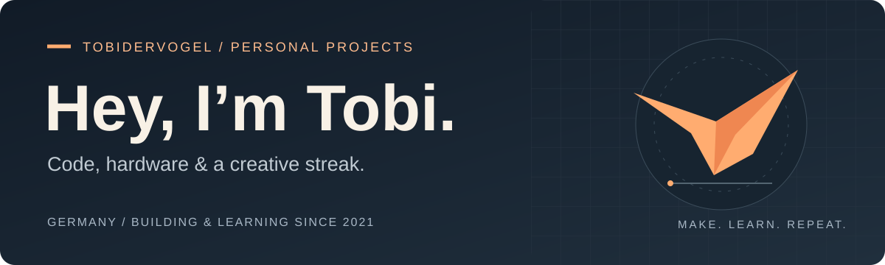

# Tobi · Tobidervogel

I’m a maker from Germany. I started coding in 2021 with HTML and CSS, then picked up Python. I enjoy turning ideas into things I can use, from websites and personal apps to small hardware projects.

   

[How I got started](#how-i-got-started) · [Beyond code](#beyond-code)

## What I like working with

- **Web & scripting:** HTML, CSS and Python — where I started and tools I keep exploring.
- **Apps & hardware:** connecting software to things I can actually use.
- **Visual work:** Blender models and animations, drawing, photography and video editing.

## How I got started

My first ideas were a Christmas website and a website for my mom. I began with Wix, then moved to HTML and CSS when I wanted to build it myself without the paid storage limitation.

After a break, I came back to coding, built more websites and started learning Python. Along the way, I also got into photo and video editing and the wonderfully large world of Blender.

That mix of code and creativity is still what I enjoy.

[An early website: Survivalmom](https://www.jacob-familie.de/survivalmom)

## Beyond code

I draw, make Blender models and animations, and create photos and videos. I also play Minecraft — my GitHub bio puts it this way: **“I play Minecraft but with Code.”**

<details>
<summary><strong>Coding activity · WakaTime</strong></summary>

[View my WakaTime profile](https://wakatime.com/@e75f6892-560e-4206-ae97-04d59c14c0a0)

<!--START_SECTION:waka-->

```txt
No activity tracked
```

<!--END_SECTION:waka-->

<sub>Tracked editor activity, when available; not a measure of experience or all project work.</sub>

</details>

---

<sub>Built out of curiosity. Always learning by making.</sub>
